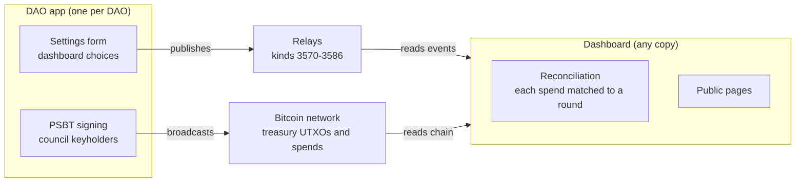

# btc-dao dashboard spec (draft 0.1)

November 2026. The read-only dashboard at btcdao.tech, built on the events in [`protocol.md`](protocol.md). It adds no new event kinds.

## 1. Purpose and principles

The dashboard is a block explorer for governance: it shows that btc-dao DAOs run, decide and spend only as agreed, without showing who their members are.

1. **Events and keys, never people.** It shows what happened, never who someone is.
2. **Aggregate across DAOs, never link across them.** Identity keys are already per DAO (salted with the DAO id); the dashboard never correlates keys between DAOs.
3. **Opt-in display.** Every DAO event is public on relays by design (members consent to a public record). The dashboard still shows a DAO only if it chooses to be listed, and only the data points it chooses.
4. **A reader, not a registry.** The dashboard reads what DAOs publish and what the chain shows. There is nothing to register with and no account to hold. A btc-dao DAO starts publishing, and any dashboard that speaks the protocol picks it up, just as a Bitcoin node joins the network without asking permission.
5. **Verifiable, not trusted.** Every figure links to its source: a txid, a signed event, or a published descriptor. Anyone can run their own copy and get the same numbers.

## 2. Key metric: the reconciled treasury

The headline for every listed mainnet DAO is its whole on-chain treasury history, reconciled in real time, with **unauthorised spends: 0**. No registered company, co-op or association can show its members this.

**How reconciliation works**

1. The dashboard derives every treasury address from the descriptors in the DAO's endorsed `dao.settings` versions, current and earlier, and follows the full on-chain history: every receive, every spend, every UTXO.
2. For each spend, it looks for a `dao.round` (3581) whose unsigned transaction has that txid, and checks the round the way clients already do (protocol section 6.1): outputs are exactly the payouts of passed, tallied proposals, plus change to the treasury.
3. Each spend gets one status:
   - **Authorised**: matches a valid round (payout, closing, council-change migration or sweep round).
   - **Pending match**: seen in the mempool or a block, but no matching round has reached the dashboard yet.
   - **Unauthorised**: confirmed, and no valid round matches after a grace period.
4. The counter shows the number of unauthorised spends, with a link to each.

Because a round's txid is fixed by its unsigned transaction, a matching round proves the spend is exactly what the members voted for. `dao.receipt` (3583) confirms it; the dashboard checks the chain itself rather than trusting the receipt.

**What it proves, and what it doesn't.** It proves the treasury has moved only on recorded decisions. It does not prove the decisions were wise, or that a payee delivered.

## 3. Data sources and architecture

The dashboard has two inputs and writes nothing back: the DAO's signed events on relays, and the Bitcoin chain.



- **Events** are the protocol's kinds 3570–3586, found by the `D` tag of each listed DAO on the relays named in its listing.
- **The chain** is read through the dashboard's own node or Electrum server, never a third-party explorer.
- **No database of record.** The dashboard can be rebuilt from scratch at any time from relays and the chain, following protocol section 8 (rebuilding state).

## 4. Discovery

**Key feature: permissionless listing.** A DAO appears on the dashboard through its own `dao.listing` (3585), endorsed by `threshold` council members as the protocol already requires. Every DAO and every dashboard copy is independent; there is no curated list, no registry and no approval step.

- **The dashboard listens** for endorsed listings on the public relays and starts reading any DAO that has one.
- **Spam limits itself.** An unendorsed listing is ignored. A listed DAO with no funded, reconciled treasury shows as such, and any copy may hide unfunded listings.
- **Front page counts mainnet only.** DAOs in their practice or testnet stage are not counted in network totals. Whether testnet stages publish to relays at all is an open question (section 10).

## 5. Dashboard settings form

Each DAO chooses what the dashboard shows from one form page in its own app. Every data point is a box; all boxes start unticked, and an unticked box means the dashboard does not display that data point.

The form writes its choices into the listing, as a proposed optional `dashboard` field in the `dao.listing` content (an addition to protocol section 7.2, not a new kind):

```json
"dashboard": {"listed": true, "show": ["profile", "totals", "treasury", "reconciliation", "counts", "proposals", "tallies"]}
```

A new listing version needs `threshold` endorsements, so changing the choices follows the same rule as any listing change. A listing with no `dashboard` field, or with `"listed": false`, is not shown.

| Group | Data point (one box each) | What the dashboard shows | Needs |
| --- | --- | --- | --- |
| Listing | `listed` | The DAO appears at all | — |
| Listing | `profile` | Name, site, stage | listed |
| Listing | `totals` | Its figures join the front-page aggregates | listed |
| Treasury | `treasury` | Balance, UTXOs, full on-chain history, multisig policy | listed |
| Treasury | `reconciliation` | Authorised and unauthorised spend counts | treasury |
| Membership | `counts` | Number of members and council members | listed |
| Governance | `proposals` | Titles, numbers, dates and status | listed |
| Governance | `proposal_text` | The full proposal | proposals |
| Governance | `payouts` | Amount and destination of each payout | proposals |
| Governance | `tallies` | Yes, no, abstain, quorum, result | proposals |
| Governance | `votes` | Each vote under the member's roster name | tallies |
| Activity | `feed` | The DAO's events in the front-page feed | listed |

"Tallies only" and "full records" are two common combinations of boxes, not separate modes.

**Honest limit.** The boxes govern what this dashboard displays. They do not make anything private: every event is on public relays, and anyone running their own reader can see it. The form page in the app must say so.

## 6. Network view (front page)

The front page answers one question at a glance: are btc-dao DAOs real, active and clean? It works like a mempool front page, with headline figures on top and a live feed below. Only DAOs that ticked `totals` feed the figures.

**Headline figures**

- **Unauthorised spends, all DAOs: 0**: the lead figure, largest on the page.
- Listed DAOs, mainnet only.
- BTC held in mainnet treasuries, summed from their descriptors.
- Spends reconciled to date.
- Proposals currently open for voting.

**Health figures**

- Median time from a tally to the payout's receipt.
- Turnout distribution across proposals.
- Share of passed payouts paid before they lapse.

**Live feed**

Events stream in as they are published or seen on chain: DAO listed, proposal opened, tally published, round published, round fully signed, payout confirmed, spend reconciled. Each entry names the DAO and links to the proposal page or the transaction. No entry names a member.

## 7. DAO page

Each listed DAO has one page, like an address page in a block explorer. It shows only the boxes the DAO has ticked; a missing data point does not appear, with no placeholder.

**Header**

- Name, site, stage, software version and build check (protocol section 7.2).
- The reconciliation badge: authorised spends and **unauthorised spends: 0**, with the time of the last check.

**Treasury**

- Current balance and UTXO list, and the donation cap if one is set.
- The full transaction history from the first deposit, across every descriptor the DAO has used, each row a link to the transaction, tagged received, authorised spend, pending match or unauthorised.
- Balance over time.
- Multisig policy, for example 3-of-5.

**Governance**

- Member count and council count.
- Proposal list, newest first, with number, status and tally; each opens its proposal page.
- Spending over time, by round.

## 8. Proposal page

Each proposal has a page like a transaction page: one timeline from opening to payment, each step with its time and the event that proves it.

1. **Opened**: `dao.proposal` (3574). Title, and the text if published.
2. **Confirmed**: `dao.confirm` (3575), where the payout recipient must confirm the address.
3. **Voting**: open until the close time; individual `dao.vote` (3576) events only if the DAO ticked `votes`.
4. **Tallied**: `dao.tally` (3577), passed or failed, with the result. A failed proposal ends here.
5. **Anchored**: `dao.anchor` (3584), the OpenTimestamps proof of the record.
6. **In a round**: `dao.round` (3581).
7. **Signed**: the round reached `threshold` signatures (`dao.sign`, 3582). The page shows the count, not which council members signed.
8. **Paid**: `dao.receipt` (3583), txid and block height, and the spend marked authorised by reconciliation.

A proposal that moves no funds stops at step 5. A passed payout not paid by its second round date shows as lapsed (protocol section 6.1).

## 9. Never displayed

These are not boxes on the form; the dashboard never shows them for any DAO.

- The roster, or anything tying a key to a legal name.
- Any link between keys in different DAOs, including shared payout addresses.
- Labels on payout recipients beyond the address and txid the chain already shows.
- Network metadata: IP addresses, locations, devices, relays a member used.
- Rankings or scores of individual members.

**What is public anyway.** All events are on public relays, the descriptor is in the listing, and with the current P2WSH multisig each spend shows on chain which council keys signed. Each DAO should tick the treasury box knowing this. Members should use a fresh receive address for every payout, which the app should request automatically.

## 10. Open questions

- [ ] Should testnet stages (practice and testnet) publish their events to relays, or keep all data local to the DAO? The protocol currently publishes them through the DAO relay; the alternative is that only mainnet publishes, with the dashboard form enabled only at the mainnet stage.
- [ ] Add the optional `dashboard` field to `dao.listing` in `protocol.md`?
- [ ] Grace period before a confirmed, unmatched spend is marked unauthorised.
- [ ] Should a DAO be able to hide which council keys signed (for example with a Taproot multisig)?
- [ ] Who hosts the reference instance at btcdao.tech, and how do others run their own?
- [ ] The protocol has no delivery event, so "delivered" is not shown. Is one wanted?

## 11. Tasks

- [ ] Add the dashboard settings form page to the DAO app.
- [ ] Confirm kinds 3570–3586 and the `D` tag are free (already open in `decisions.md`): check the NIPs Event Kinds table, query large relays, search GitHub code. None appeared in the June 2026 registry ([mirror](https://d-central.tech/nostr-event-kinds-reference/)).
- [ ] Write the protocol up as a draft NIP, with the app (publisher) and the dashboard (reader) as its two implementations, and submit a pull request to nostr-protocol/nips after the first mainnet DAO.
