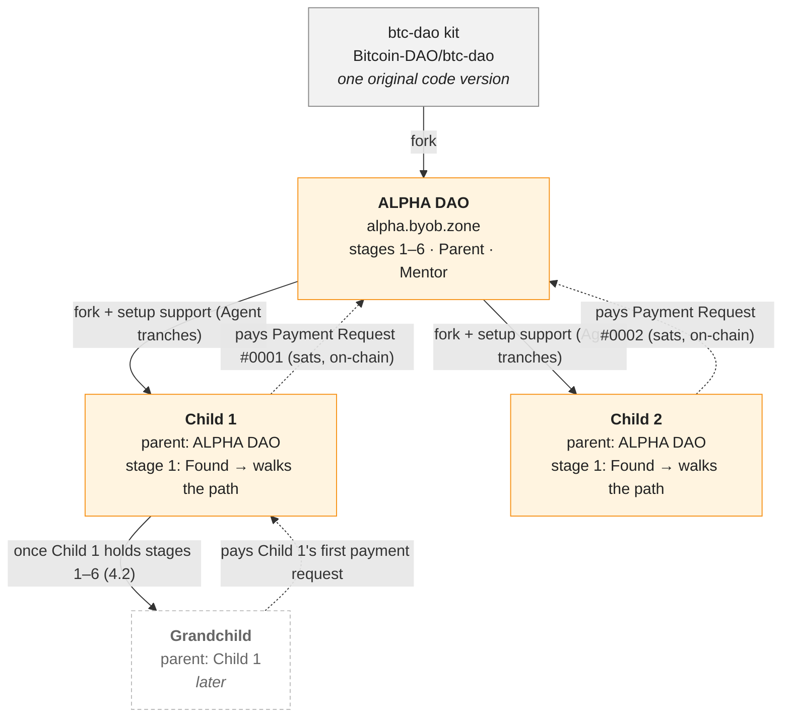

# Tiers, stages and badges (proposal)

Status: proposal, 15 November 2026. Not part of the protocol yet. Members' badges first, after ALPHA DAO's founding; council badges and the DAO tier to be decided after ALPHA has run some rounds. Numbers marked *to tune* are starting points, not decisions.

## The growth model

A DAO grows in three tiers: **members**, the **council**, and **DAOs** themselves, each new one forked from the kit. Each tier starts from a **hard minimum** (the least that is safe and still works) and grows by its own rules, never by anyone's say-so:

- a hard minimum is a floor the app enforces: below it, the step cannot be taken at all;
- every step up is visible in the DAO's record, so a badge can show it and anyone can check it;
- nothing is skipped: a DAO founded at the minimum grows the same way as any other, by vote.

Badges mark the steps. Every badge is **computed from a DAO's own record** by the same code that counts votes and checks rounds: nobody issues, approves or fakes one, and any phone can check it. Badges carry no votes, no rank and no say: every member counts the same (protocol 3.3).

| | Members | Council | DAOs |
| --- | --- | --- | --- |
| Hard minimum | a name, a key, and the DAO's verification (founding or vote) | 2 council members to found | a council of 2, on its own site |
| Grows by | doing: wallet, vote, proposal, delivered work | a council change, by vote | stages: practice → testnet → mainnet; and forks |
| Identity | anonymous: the DAO's own key (1.4) | the same, plus an optional link to a personal npub | its DAO id, and its parent if forked |
| Badges count | inside the DAO | inside the DAO, and wherever linked | on byob.zone and any dashboard |

## 1. Members

### 1.1 Stages and minimums

| Stage | Hard minimum (today) |
| --- | --- |
| Founder | signed up at the founding meeting and listed in the genesis, which the council endorses (3.5) |
| Member | sponsored, verified (one in person, or two remote checks by different council members) and voted in (4.1, 5.1) |

### 1.2 Badges: learning by doing

Each badge is one task done for real in the DAO; a member who has all four has used every part of the DAO a member uses. Shown on byob.zone as "Learning by doing", and on the member's own Profile in the app.

| Badge | Task | Earned when the record shows | Protocol |
| --- | --- | --- | --- |
| 1. Wallet | Add your bitcoin address to your profile | a valid standing payout address of theirs (a `dao.confirm` with no `e` tag) | 4.2 |
| 2. Voice | Cast a vote on an open proposal | a vote of theirs counted in the valid tally that settled a proposal | 4.3, 4.4 |
| 3. Proposer | Publish a proposal, even a small one | a proposal of theirs taken into the numbering, whatever its outcome | 4.1 |
| 4. Builder | Claim a bounty, deliver it, report it | a bounty they were chosen for, their report, and a tranche paid to them in a paid round | 4.6 |

- **Wallet** shows a valid address for the DAO's network, not that the member holds its keys; Builder proves that, when their first payout arrives there.
- **Counted, not just cast:** Voice needs a vote a valid tally counted (4.4); a vote after the close, or from a non-member, earns nothing.
- **Per person,** not per key: a member whose key was replaced (5.2) keeps what they earned.
- **Privacy:** shown inside the DAO beside the member's DAO name; outside it (byob.zone) only totals, such as "12 of 15 members have a wallet", never who.
- **Rewards** are an ordinary bounty: the DAO votes a "badge bounties" payout once, with an amount per badge; a member who holds a badge claims it; the council pays it in a round, **once per member and badge**.

#### 1.2.1 Paid-up (proposed, 23 November 2026)

A fifth member badge, for the other half of a member's wallet. **Wallet** shows the member can receive at their standing address; **Paid-up** shows they hold its keys and have paid in from it. In a DAO with dues (the Association kit, [`drafts/use-case-kits.md`](../drafts/use-case-kits.md)) it is the membership badge: it shows the member is paid up.

| Badge | Task | Earned when the record shows | Protocol |
| --- | --- | --- | --- |
| 5. Paid-up | Pay your dues to the treasury from your standing address | a confirmed transaction that spends a coin from the member's standing address and pays at least `rules.duesSats` to a treasury address | 4.2 (standing address), 6.4 (treasury addresses) |

**No extra steps.** Everyone pays the same amount, `rules.duesSats`, to the treasury address shown on the treasury page, from the wallet that holds their standing address. There is no notice to publish, no special amount and no txid to paste: every client reads the chain and sees which member's standing address the coin came from.

- **Attribution cannot be faked.** Only the holder of the standing address's keys can spend from it. Someone else paying for a member earns no badge; a member cannot claim another's payment.
- **It proves key control,** which Wallet does not (Wallet shows a valid address; Builder shows a payout arrived there; Paid-up shows the member spent from it).
- **Which coin:** a wallet holding several coins may spend one that is not at the standing address. The member should pay from a wallet whose only coin, or chosen coin, is at the standing address. In ALPHA DAO's peer-to-peer rehearsal ([`MAINNET-READINESS.md`](../../MAINNET-READINESS.md) section 10) this is natural: the seller sends tBTC to the member's standing address, and the member pays their dues from that coin. Bought, received, paid in: two transactions, both on the record.
- **Fallback:** if the payment came from another coin, the member posts its txid on their profile; it counts once a council member confirms it, as for a member loan's funding ([`drafts/member-loans.md`](../drafts/member-loans.md)). This is the only step a person takes, and only when the automatic route missed.
- **Dues rules:** `rules.duesSats` and `rules.duesPeriod` (for example monthly or yearly), set at founding or by an ordinary rules vote. Setting dues is the decision; each payment is a record, not a proposal. In a new DAO this is usually one of the first proposals: whoever proposes it earns Proposer, the voters earn Voice, and paying earns Paid-up.
- **Only once dues are in force.** The **Pay dues** prompt (on Home and the Profile) appears only when `rules.duesSats` is set in the rules version in force, that is, after the dues proposal has passed, been tallied and the council has confirmed the new rules version. It shows the confirmed amount and the treasury address. A payment counts only if it confirmed while dues were in force, so a member who pays early, or the wrong amount before the rules change, earns nothing until they pay again under the confirmed rules.
- **DAOs without dues:** while `rules.duesSats` is unset, there is no prompt and no Paid-up badge; the Profile shows four badges.
- **Once or current?** The badge, like the others, stays once earned. Whether a member is paid up *for this period* (a qualifying payment dated within it) is a separate status on the Members page, shown only inside the DAO.
- **Standing address changes:** a payment counts if it spends from the standing address in force when it confirmed, or from any earlier standing address of the same member.
- **What it does not prove:** that the member *bought* the bitcoin. On a testnet DAO the coins may come from a faucet or another member.
- **Privacy:** the standing address is already public on the record and exempt from the reuse warning (4.2), so linking it to dues payments reveals nothing new. Shown inside the DAO beside the member's name; outside it, totals only ("14 of 15 members paid up").
- **Accounts:** dues are an inflow line of their own in Accounts ([`drafts/payments-and-accounts.md`](../drafts/payments-and-accounts.md)), and count as steady inflow for a `mutual` DAO ([funding models](../funding-models.md)).

With Paid-up, "the four member badges" becomes five wherever this document and the competence path (section 4) count them, once it is built.

**Built in v0.9.5, Home card as in v0.9.7** (`core/badges.ts`, `ui/Badges.tsx`), decided 16 November 2026:

- **An onboarding tool, shown only to the member:** a "Learning by doing" card on their own Profile, with how to earn each badge or what earned it. Not on the Members page.
- **On Home, for information:** below the donation card, the four badges and the next step, worked out at every load, until all four are earned. No buttons; the Wallet card at the top is the one thing flagged.
- **Wallet stays once earned.** If the address later lapses, the Profile says so and the Home card asks again.
- **Share in the group** from the Profile's badges card ("@anna: Voice, Proposer ✓ Learning by doing").

**Next round of changes** (decided 16 November 2026): the Profile's badge tiles lose their links ("See the bounty", and likewise "Go to the votes" and "New proposal"), with no text in their place; and the Home badge card loses its "The details are on your profile" link: learning to find the Proposals page from the footer, and the Profile from the header, is part of learning by doing.

**Badge bounties are paid once per member and badge** (decided 16 November 2026). To build when a DAO first votes one: the bounty proposal names the badge it rewards, a claim counts only from a member who holds that badge, and the app refuses a round that pays the same person for the same badge twice, as it refuses any payout paid twice.

### 1.3 Agent and Operator badges (17 November 2026)

*Proposed,* for the roles in [`drafts/action-gateway.md`](../drafts/action-gateway.md) section 3. Earned by doing, like the four above; counted, so a profile reads "Agent: 7 tasks (4 reporting, 2 physical, 1 digital)".

| Badge | Earned when the record shows |
| --- | --- |
| Agent | a task claimed, reported and paid in a round (4.6) |
| Local Agent | the same, for a task with a region |
| Operator | voted in as an Operator, and a handover ceremony completed with its closing receipt |

Council members are not Agents, so a council member never earns Agent badges in the DAO where they hold a seat.

## 2. Council

### 2.1 Stages and minimums

| Stage | Hard minimum |
| --- | --- |
| Founding council | **2 members** (today: the founding cannot be published with fewer). 2 of 2 is allowed, with a warning that every key is then needed |
| Spare key | a council where the signatures needed are fewer than the seats (2 of 3, 3 of 5): one lost key no longer locks the treasury. Reached by a council change |
| Mainnet council | every treasury key on a SeedSigner (today: enforced by the app at founding); *proposed:* a spare key too |

A council grows only by a `change_council` vote, which moves the treasury to the new council's wallet (6.6): a 2-of-2 council can vote more members onto the council later, and raise the signatures needed as it grows.

### 2.2 A portable record: link, don't log in

A council seat is a role of trust, and today that trust starts from zero in every DAO. A council member who chooses to can link their seat to a personal Nostr key, so that other DAOs can read what they did: "co-signed 40 rounds across 3 DAOs, handed over a treasury twice".

They keep using the DAO's own key in the app; they do not sign in with their personal key, because one key would then carry every DAO they serve (a loss or leak would reach all of them at once), and every action would need an outside signer app, in the most sensitive role. Instead they publish a **link**, signed by both keys, once:

- `dao.link` (proposed kind 3593), signed by the **DAO key**: tags `D` (the DAO id) and `p` (the personal key); content `{}`;
- its counterpart, signed by the **personal key**: tags `D`, `p` (the DAO key), and the DAO's site and relays, so that any reader can find the record from the personal key alone.

A link counts only with both halves, and is offered to council members only; members stay anonymous. A later `dao.link` with `{"unlinked": true}` stops events after it being attributed, but what came before stays public: Nostr cannot reliably delete, so the app must say plainly that linking is in effect permanent for that DAO.

### 2.3 Council badges

Computed from a linked DAO's record by any app, or by byob.zone the way its pulse is computed:

| Badge | Earned when the record shows |
| --- | --- |
| Founding council | on the council in the founding settings (3.1, 3.4) |
| Keyholder | their treasury key's verified signature used in a paid round (6.1–6.3), counted: "signed 12 rounds" |
| Handover | signed a round that moved the treasury to a new council's wallet (6.6) |
| Recovery | a lost or replaced treasury key changed through the council rules, with the treasury moved (6.5, 6.6) |

Each is shown **with its context**: the DAO's age, members, treasury and what its rounds paid, so "12 rounds in a 3-member DAO holding 5,000 sats" reads differently from a large, long-running one.

To weigh: **safety** (a public key tied to "holds a key to a treasury of X sats" makes a person a target, on mainnet above all: a plain warning, and a pseudonymous key is fine); **honest records** (linking a DAO links all of it, a removal included; members choose which DAOs to link, so readers still judge); **gaming** (a small DAO founded to collect badges: the context shows what they are worth).

## 3. DAOs: forked from the kit

Every DAO is a fork of the kit: its own repository, its own site, its own record (ALPHA DAO is `byob-zone/alpha-dao`, at alpha.byob.zone). The third tier is the DAOs themselves: how a new one is founded, how it grows up, and the family they form.

### 3.1 Stages and minimums

The genesis config already names a DAO's stage (`stage`: practice, testnet or mainnet), and dashboards keep trial stages apart (7.4).

| Stage | Hard minimum |
| --- | --- |
| Practice | a council of 2, founders optional; ten-minute votes; testnet4 |
| Testnet | the same, with real vote lengths, or kept short by a rules vote |
| Mainnet | today: every treasury key on a SeedSigner. *Proposed* (checked by the app before a mainnet founding, and shown on byob.zone): a site of its own (review I-1), its relay pinned to its DAO id, a council with a spare key, and a trial behind it (below) |

A DAO moves up a stage by being **founded again** at the next stage, as UNO did: the new DAO lists the earlier one's members as founders, so no one is voted in again (3.5). Each stage is its own DAO, with its own id and record; the earlier one can then close.

*Proposed* trial before mainnet, *to tune*: at least one month on testnet, at least one council change, and at least three payout rounds paid, so the council has signed, recovered and handed over before real money is at stake.

### 3.2 Forks and lineage

*Proposed:* an optional `parent` in the genesis config, naming the DAO it was forked from (a DAO id), with the parent's site and relays. It records lineage only: the parent has no say over the child, and the child inherits nothing but the record of where it came from.

- a DAO founded **at the next stage** names the earlier stage as parent (UNO testnet → UNO mainnet);
- a DAO founded **by members of another** names it (a group from ALPHA DAO founds BOSA DAO);
- byob.zone shows the family: each DAO with its stage, its parent and the DAOs forked from it.

**The tree** (17 November 2026). Bitcoin itself began as one code version, cloned and forked. btc-dao grows the same way: one kit, each DAO a fork of another, and the lineage drawn on byob.zone as a tree. With payment requests ([`drafts/payments-and-accounts.md`](../drafts/payments-and-accounts.md)), the tree also becomes a trade network: a parent DAO sells setup support to the DAO it helps into being, and the child pays it, both on the record (3.3, Mentor).

Forking is also the exit: members who disagree with their DAO can found their own, taking their record with them (their council badges are portable, 2.2), without asking anyone.

### 3.3 DAO badges

Shown on byob.zone beside each DAO's pulse, computed from its record:

| Badge | Earned when the record shows |
| --- | --- |
| Founded | an endorsed genesis (3.1) |
| First payout | a payout round paid (6.3) |
| Spare key | a council with fewer signatures needed than seats |
| Grown | a council change passed and its treasury moved (6.6) |
| Learning | every member holds the Wallet badge (1.2) |
| Parent | another DAO names it as parent (3.2) |
| Mainnet | a mainnet DAO meeting the minimums in 3.1 |

*Proposed* (17 November 2026), trade between DAOs and with the outside world:

| Badge | Earned when the record shows |
| --- | --- |
| First sale | a payment request paid in full |
| First purchase | a payout round paid to an address of another btc-dao treasury, matching that DAO's payment request |
| Trading partner | a first sale and a first purchase with the same DAO |
| Mentor | a paid sale of setup support to a DAO that names it as parent (3.2), by a DAO holding the competence path's earlier stages (4.2) |
| Correspondent | an email sent after a passed correspondence proposal |
| Open books | a statement published, every payment request matched or closed |

**Proof from public descriptors.** Both treasuries' descriptors are public (protocol 6.5, 6.6), so a DAO-to-DAO payment is proved from the two descriptors alone: the buyer's treasury spent to an address of the seller's treasury, matching the request's reference. No one declares it, and no one can fake it.

**Context against gaming.** Two DAOs run by the same people could trade to collect badges. As for council badges, each is shown with its context: both DAOs' ages, members, and the number of distinct people who signed each side.

### 3.4 To build

- protocol: `parent` in the genesis config; the two link events (2.2); the badge definitions above;
- the app: the mainnet checks (3.1) before a mainnet founding; "Link your record" on a council member's Profile, signing the personal half through an outside signer (Amber, a browser extension or a remote signer);
- byob.zone: members' badge totals and DAO badges in each DAO's pulse; the family of DAOs; a reader for linked council records.
- the competence path (4): the progress line per DAO on byob.zone, and the 4.2 check before a sale of setup support counts for Mentor;
- with the action gateway and payment requests: Agent, Local Agent and Operator badges (1.3); the trade badges and the descriptor check for DAO-to-DAO payments (3.3); the family tree on byob.zone showing trade between DAOs as well as lineage.

## 4. The competence path

*Proposed,* 17 November 2026. Every DAO aims to build competence across **all** stages: from the first council of two, through the four member badges, to supporting the founding of child DAOs. The badges in sections 1 to 3 are one path, and it ends where a DAO can teach the next one.

### 4.1 The stages

| Stage | The DAO can… | Badges |
| --- | --- | --- |
| 1. Found | start with a council of 2 and a record | Founded (3.3), Founding council (2.3) |
| 2. Learn | have every member use every part of the DAO | Wallet, Voice, Proposer, Builder (1.2) → Learning (3.3) |
| 3. Pay | run a payout round signed by its council | First payout (3.3), Keyholder (2.3) |
| 4. Endure | lose a key, grow the council, move the treasury | Spare key, Grown (3.3), Handover, Recovery (2.3) |
| 5. Operate | run its infrastructure and act in the world | Operator, Agent, Local Agent (1.3), Correspondent (3.3) |
| 6. Trade | sell, buy, and keep honest accounts | First sale, First purchase, Open books (3.3) |
| 7. Mature | go live on mainnet | Mainnet (3.3) |
| 8. Reproduce | support the founding of a child DAO, paid for it | Parent, Mentor, Trading partner (3.3) |

- **A guide, not a gate.** Stages overlap in practice (a DAO may earn Correspondent before Grown). The order is for learning; the one gate is 4.2.
- **The child repeats the path.** A forked DAO starts at stage 1. From its parent it gets help, not badges: competence is earned, never inherited (as council badges are portable for people, 2.2, but each DAO earns its own).
- **On byob.zone:** a progress line beside each DAO in the tree, so the family shows how far each has grown.

### 4.2 Teach only what you have done

A DAO sells setup support only up to the stage it has reached itself: to support a **testnet** founding, it holds stages 1 to 6; to support a **mainnet** founding, it also holds stage 7. Mentor (3.3) counts only a sale made within this rule. A buyer can check it on the record: the seller has done every step it offers to teach.

*To confirm:* this lets ALPHA DAO, a testnet DAO, make Payment Request #0001 ([`drafts/payments-and-accounts.md`](../drafts/payments-and-accounts.md) 6) for a testnet child once it holds stages 1 to 6, and support mainnet foundings only after its own.

### 4.3 The tree: a first and a second child

The kit is the root; ALPHA DAO is the first DAO; its first two children are founded with its paid setup support. A child becomes a parent in turn only once it has walked the path itself (4.2), so early on the first DAO supports both.

Solid arrows are lineage (`parent` in each child's genesis, 3.2); dotted arrows are payments, each proved from the two public descriptors (3.3). What each DAO earns from the picture:

| DAO | Earns |
| --- | --- |
| ALPHA DAO | Parent, First sale, Mentor (after #0001), Trading partner (if it also buys from a child) |
| Child 1, Child 2 | Founded, First purchase; then the path from stage 2 |
| Child 1, later | Parent, First sale and Mentor of its own, once the grandchild is founded (4.2) |

The Agents who deliver the setup support earn Agent badges (1.3); the Operators who run each child's handover ceremony earn Operator.

### 4.4 Gaps in the growth loop (open)

Recorded 17 November 2026. The loop above is complete as a design; these four questions remain before it runs on its own.

- [ ] **Kit updates across the tree.** Every DAO is a fork; a security fix or a v2 of the kit must reach DAOs on different versions. Bitcoin's own upstream problem: someone maintains the original, each DAO chooses to upgrade. Needed: the kit version shown on the dashboard, an upgrade proposal, and a way to fund kit maintenance (for example, a voluntary share of mentoring income sent upstream)
- [ ] **Two-sided lineage.** Today a child names its parent in its genesis alone (3.2), so anyone could claim ALPHA DAO as parent. Mentor is safe (it needs a paid sale), but the tree on byob.zone should need the parent's acknowledgement too, two-sided like `dao.link` (2.2)
- [ ] **Mentoring capacity.** Early on, the first DAO mentors every child until its children reach stage 6 (4.2): growth is paced by how many mentoring tasks its Agents can take. Probably healthy; to watch, and to show on byob.zone
- [ ] **Failure and closure.** DAOs will close. The tree shows closed branches honestly (closing exists in the protocol; this is a display rule), with what each achieved before it closed
